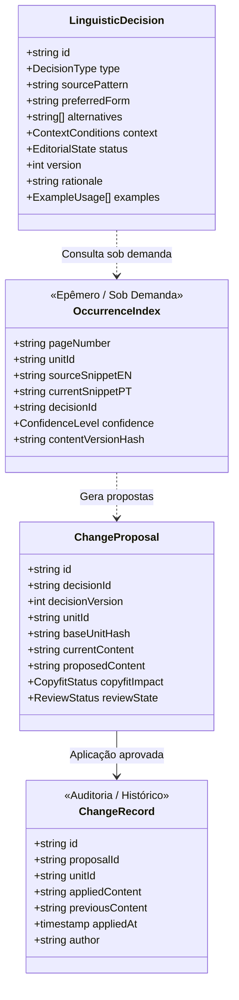
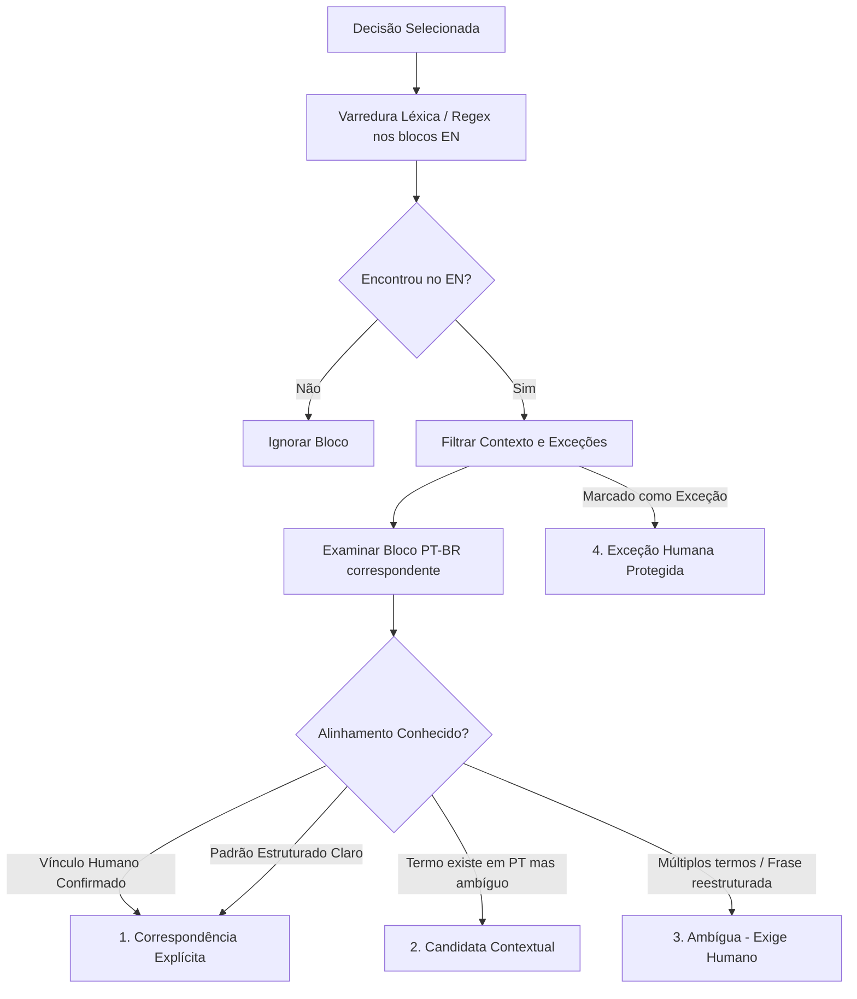

# Projeto Pendente: Gerenciador de Decisões Linguísticas e Glossário Semântico

- **Status:** PLANEJADO / EM REVISÃO ARQUITETURAL
- **Prioridade:** ALTA (Arquitetura Editorial e Consistência)
- **Área:** Engenharia Editorial / Modelagem de Dados / Gestão de Tradução
- **Diretriz Central:** *Não construir um sistema que tenta entender semanticamente todo o livro antecipadamente.*

---

## 1. Problema de Produto

O livro de regras do Middara possui 102 páginas densas, com terminologia mecânica rigorosa, convenções editoriais estritas e interdependência de componentes físicos (cartas, dados, fichas, diagramas). Ao longo da tradução, a equipe enfrenta decisões que afetam transversalmente todo o livro:

- **Terminologia:** `Bounty → Recompensa` (diferente de `Reward`), `Tier → Tier`, `Exhaust → Exaustar`.
- **Estilo editorial:** referências obrigatórias a seções e páginas usando `Veja` (nunca "Consulte", nunca "Veja em").
- **Padrões de escrita estruturados:** `See Diagram Book, Pg. 19.` → `Veja Livro de Diagramas, pág. 19.`
- **Restrições semânticas e homógrafos:** `Bounty` e `Reward` compartilham em certos contextos a tradução histórica `Recompensa`, mas representam conceitos de jogo distintos; alterar `Bounty` não pode modificar indevidamente ocorrências de `Reward`.

### Dor Atual
As decisões estão distribuídas entre arquivos Markdown estáticos (`docs/translations/glossary.md`, `editorial-casebook.md`), regras de memória de agentes e scripts ad-hoc. Isso obriga editores a inspecionar arquivos manualmente, confiar na memória e recorrer a buscas regex arriscadas. Substituições textuais cegas ameaçam a integridade tipográfica, rich spans e o pipeline Copyfit V3.

### Solução Desejada
Uma experiência editorial simples e integrada: **registrar uma decisão, descobrir onde ela se aplica sob demanda e revisar suas consequências com segurança**.

---

## 2. Escopo Inicial (Eliminação de Complexidade Desnecessária)

Para evitar engenharia excessiva, a arquitetura elimina premissas infladas:
1. **Sem classificação prévia do livro:** O sistema **não** analisa previamente nem classifica semanticamente todas as palavras das 102 páginas.
2. **Sem múltiplos subsistemas redundantes:** Terminologia, estilo e padrões são tratados como variantes de uma **única entidade conceitual**, sem criar 4 subsistemas isolados.
3. **Sem sincronização distribuída no MVP:** O sistema inicial opera no ambiente de trabalho existente (Node.js/Payload/SQLite local).
4. **Sem geração de DOCX no MVP:** O foco imediato é a consulta na interface, exportação leve (JSON/CSV) e visualização no aplicativo.

---

## 3. Modelo Conceitual Mínimo

O modelo é unificado em **três responsabilidades persistentes essenciais** e um **índice reconstruível em memória**, baseados em identidades estáveis e aproveitando as estruturas já existentes no projeto.

### A. LinguisticDecision (Entidade Central)
Representa qualquer decisão linguística, termo ou regra de redação:
- `id`: Identificador único estável (ex: `dec_bounty_term`, `dec_see_editorial_ref`).
- `type`: Tipo da decisão — `'terminology'` | `'editorial_style'` | `'writing_pattern'`.
- `sourcePattern`: Termo ou estrutura em inglês (ex: `"Bounty"`, `"See {target}, Pg. {page}."`).
- `preferredForm`: Forma oficial aprovada (ex: `"Recompensa"`, `"Veja {target}, pág. {page}."`).
- `alternatives`: Lista de sinônimos, formas históricas ou termos rejeitados (ex: `["Caçada"]`, `["Consulte", "Veja em"]`).
- `context`: Restrições e escopo mecânico (ex: `{ distinctFrom: "Reward", component: "cards" }`).
- `status`: Estado editorial — `'APROVADO'` | `'PADRÃO_OBSERVADO'` | `'EXPERIMENTAL'` | `'HIPÓTESE'` | `'REJEITADO'`.
- `version`: Inteiro incremental para controle de concorrência otimista.
- `rationale`: Justificativa editorial e histórico de discussões.
- `examples`: Exemplos práticos anexados diretamente à decisão, sem necessidade de entidades separadas.

### B. OccurrenceIndex (Índice Sob Demanda)
**Não é uma tabela permanente do banco de dados.** É um índice gerado em memória ou sob demanda a partir das unidades tipográficas existentes (`page_XXX_dom.json` / Payload CMS):
- Aponta para `pageNumber`, `unitId`, trecho EN original, tradução PT-BR atual.
- Registra a decisão associada, nível de confiança e hash de versão do conteúdo analisado.
- Somente confirmações humanas explícitas e exceções marcadas necessitam de persistência durável (armazenadas como atributos leves na unidade ou arquivo de vínculos confirmados).

### C. ChangeProposal (Proposta de Alteração)
Reaproveita o formato de propostas já existente no projeto (`docs/translations/proposals/` e gaveta de revisão):
- Relaciona: `decisionId` (+ versão da decisão), `unitId`, `baseUnitHash` (versão da unidade no momento da geração), texto atual e texto proposto.
- Avalia previamente o impacto no Copyfit V3 (`EXACT`, `UNDER`, `OVER`).

### D. ChangeRecord (Rastreabilidade e Rollback)
Aproveita os mecanismos de histórico e commits existentes no ecossistema Payload/Git, armazenando o diff aprovado, autor, data e dados para reversão segura.

---

## 4. Fonte de Verdade e Integração com Skills

### Estrutura Real Atual
- `docs/translations/glossary.md`: Tabela Markdown com ~60 termos de jogo.
- `docs/translations/editorial-casebook.md`: Registro de casos com estados APROVADO, EXPERIMENTAL, etc.
- Payload CMS / SQLite: Armazena o estado das páginas e blocos aprovados.
- Skills dos Agentes (`middara-translation-expert`): Diretrizes textuais consumidas pela IA.

### Fonte Canônica Proposta
1. **Repositório Estruturado Único:** Um arquivo canônico serializado em JSON versionado no Git (ex: `packages/glossary/linguistic-decisions.json`) ou coleção nativa no Payload CMS sincronizada com o repositório.
2. **Importação Não-Destrutiva:** Migração dos dados de `glossary.md` e `editorial-casebook.md` preservando todas as justificativas, estados e decisões humanas já estabelecidas (ex: "Veja", "Tier", "Fase de Manutenção").
3. **Consumo Automatizado pelas Skills:** As skills de tradução passam a ler o arquivo canônico (ou uma projeção Markdown gerada automaticamente durante o build), impedindo que existam instruções divergentes silenciosas.

### Dúvidas a Investigar
- *Investigação 1:* Armazenar o JSON canônico primariamente no sistema de arquivos Git (benefício: diffs transparentes, branches, offline nativo) com sincronização para o Payload no startup, ou gerenciar primariamente via UI do Payload com export automático para Git?
- *Investigação 2:* Qual a melhor granularidade de sincronização para garantir que o build da web app e os scripts de terminal (`scripts/*.mjs`) acessem a mesma versão sem latência?

---

## 5. Estratégia de Descoberta de Ocorrências (Sem Indexação Prévia)

A busca ocorre sob demanda, ativada quando o usuário solicita verificar uma decisão específica:

### Níveis de Confiança:
1. **Correspondência Explícita (Alta):** Vínculo já confirmado anteriormente por um humano, ou correspondência direta inequívoca (ex: estrutura `See Diagram Book, Pg. 19.` contendo `Consulte` na tradução).
2. **Candidata Contextual (Média):** Termo original presente no EN, mas o trecho PT-BR precisa de validação de escopo antes de gerar proposta.
3. **Ambígua (Baixa):** Sentença profundamente reestruturada, ou caso de homógrafos (`Bounty` vs `Reward`). A IA sugere uma leitura, mas **bloqueia qualquer substituição automática**.
4. **Exceção Humana (Protegida):** Caso em que o revisor deliberadamente optou por uma redação diferente por motivos contextuais ou de copyfit. O sistema sinaliza como exceção permanente e **nunca** propõe alterações.

---

## 6. Proteções de Versão, Concorrência e Aprovação

### Separação Obrigatória de Operações

| Operação | O que faz | Impacto no Conteúdo do Livro |
|---|---|---|
| **Operação A: Atualizar Decisão Linguística** | Modifica uma preferência no glossário (ex: muda status, adiciona termo, refina justificativa). | **ZERO.** Nenhuma tradução existente é alterada. Apenas afeta a orientação para o futuro. |
| **Operação B: Atualizar Conteúdo do Livro** | Localiza ocorrências, gera prévias, passa pelo Copyfit V3 e requer aprovação explícita no Review Drawer. | Altera blocos específicos somente após aprovação humana individual ou em lote autorizado. |

### Controle de Concorrência Otimista
Para impedir que um agente de IA ou processo em lote sobrescreva uma edição humana simultânea:
1. Toda proposta gerada registra o hash da versão da unidade (`baseUnitHash`).
2. Antes de persistir qualquer alteração no Payload ou no disco, o sistema compara `currentUnitHash === proposal.baseUnitHash`.
3. Se o bloco tiver sido editado por um humano após a geração da proposta, a gravação é **abortada** e a proposta entra em estado de `CONFLITO`.
4. Aplicações em lote retornam relatório discriminado: `{ concluidas: N, ignoradas: N, conflitos: N }`.
5. O sistema de aprovação da Central de Revisão continua sendo a autoridade única de publicação no livro PT-BR.

---

## 7. Limites da Automação Semântica e Papel da IA

- **A IA é uma assistente de redação e busca, não a autoridade editorial.**
- A IA pode sugerir reescritas e identificar correspondências prováveis, mas nunca aplicar alterações com status ambíguo sem revisão humana.
- Vínculos e exceções confirmados por humanos tornam-se regras protegidas no sistema.

---

## 8. Requisitos Offline por Nível

A arquitetura desacopla as três necessidades offline para evitar implementação prematura:

| Nível | Capacidade | Cenário Suportado | Complexidade |
|---|---|---|---|
| **Nível 1 (MVP)** | **Consulta e Exportação Offline** | Funciona sem internet. Lê decisões cacheadas localmente via bundle/IndexedDB. Exporta JSON/CSV diretamente no navegador. | Baixa |
| **Nível 2** | **Edição Local sem Backend** | Permite rascunhos locais com indicador "Rascunho não sincronizado" (reaproveitando o padrão já ativo no `RichSpanEditor`). | Média |
| **Nível 3 (Adiado)** | **Sincronização Multi-Dispositivo** | Conciliação distribuída entre múltiplos usuários com resolução remota de conflitos. | Alta (**Adiada para pós-lançamento**) |

> [!NOTE]
> No estado atual, o aplicativo opera com backend local (`localhost:3000` + SQLite). O Nível 1 atende perfeitamente ao desenvolvimento diário sem necessidade de infraestruturas externas de nuvem.

---

## 9. Integração com RichSpanEditor e Copyfit V3

Ao aplicar alterações sugeridas por decisões linguísticas:
- **Preservação de Rich Spans e Símbolos:** O sistema não utiliza offsets de caracteres brutos em textos reescritos. O mapeamento semântico associa a tag de estilo ou símbolo inline (ex: `[dice_red]`, `<b>`, `<i>`) ao token correspondente traduzido. Em caso de dúvida, a unidade é aberta no `RichSpanEditor` para ajuste visual.
- **Portão de Qualidade Copyfit V3:** Nenhuma alteração textual é aprovada se o script `measure_copyfit_all.mjs` / medição do canvas indicar status `OVER` (transbordamento de linha) ou quebra de recuo francês (*hanging indent*).

---

## 10. Fases Independentes de Implementação

**Checkpoint 2026-10-25 — Fase 1 em andamento:** a coleção Payload existente permanece canônica e recebeu metadados semânticos opcionais; a Central de Revisão agora consulta os registros com busca, filtros e exportação JSON/CSV. O piloto é pequeno e preserva IDs/histórico. Scanner de ocorrências e geração de propostas das Fases 2–4 continuam fora do escopo deste incremento. Ver `docs/project-progress/2026-10-24-semantic-glossary-pilot.md`.

### Próximo incremento priorizado: taxonomia tipada de componentes e superfície do texto

O glossário já permite registrar `category` e `subtype` dentro de `semanticMetadata`, mas esse objeto é JSON livre: não há enum validado para diferenciar componente, carta, ficha, token, diagrama ou os subtipos de carta. O próximo incremento deve substituir essa ambiguidade por campos tipados, pequenos e validados no Payload, antes de ampliar a descoberta automática de ocorrências.

O modelo deve separar pelo menos estas dimensões, sem presumir que uma mesma enum cubra todas:

- **Tipo de componente:** categoria física distinta (`carta`, `token` — chamado **Ficha** no glossário —, `Folha da Aventura`, `Ficha de Aventureiro`, `diagrama`, `peça de terreno` ou `outro`). O token e os dois tipos de folha continuam distintos.
- **Tipo de carta:** subtipo controlado quando a entidade for carta (por exemplo, Carta de Aprimoramento de Item, Carta de Arma, Carta de Saque de Monstro).
- **Superfície textual:** prosa de regra, título/nome impresso em componente, regra impressa em carta, rótulo de diagrama ou texto embutido em arte.
- **Política de localização:** traduzível nesta etapa, preservado na língua-fonte ou aguardando uma etapa editorial futura.

Não implemente um inventário prévio de todas as 102 páginas. Migre apenas registros existentes com evidência suficiente; mantenha valores desconhecidos explicitamente sem classificação e preserve `id`, `decisionStatus`, justificativas, exemplos e histórico. Campos desconhecidos não devem ser convertidos silenciosamente em valores arbitrários de enum.

**Exemplos de prova:** `Master Work` deve ser identificável como nome de uma Carta de Aprimoramento de Item; `Great Hammer`, como nome de uma Carta de Arma. Na etapa atual de localização, o nome impresso e o texto das duas cartas permanecem em inglês, enquanto a prosa de regra ao redor é traduzida. Esses exemplos validam a modelagem e a política; não autorizam traduzir as cartas.

**Caso registrado (23/11/2026):** `Adventurer Tuck Bags` e `Party Tuck Bag` são nomes de componentes e permanecem em inglês também quando citados na prosa de regras; `Party Stash → Estoque do Grupo` é uma forma distinta já aprovada. O localizador futuro deve encontrar as ocorrências nas unidades reais, mostrar o contexto EN/PT-BR e propor a correção por unidade com rich spans e copyfit preservados. Uma decisão central não deve disparar substituição cega no livro.

**Critérios de aceite:**

- O Admin apresenta opções validadas para as dimensões tipadas e rejeita valores fora do catálogo.
- `Master Work` e `Great Hammer` aparecem com tipo de componente/carta correto e política explícita de preservação da arte-fonte.
- A leitura, edição e exportação JSON/CSV existentes preservam todos os registros e metadados atuais sem reescrever traduções, IDs ou decisões aprovadas.
- Registros ambíguos continuam sinalizados como não classificados para revisão humana; a migração não inventa categorias.
- O procedimento editorial documenta que a etapa atual traduz regras e preserva texto impresso em cartas.

Este incremento de modelagem não interrompe a revisão página a página em andamento; ele fica como próximo trabalho de produto do glossário.

Cada fase entrega valor autônomo imediato, sem dependência de passos futuros:

### Fase 1: Consulta e Exportação no Visualizador (MVP)
- Adição da aba **Glossário** na Central de Revisão retrátil.
- Campo de busca instantânea e filtros por tipo e status (`APROVADO`, `EXPERIMENTAL`, etc.).
- Exibição de forma preferencial, alternativas, contexto e justificativa.
- Botão de exportação para JSON e CSV.
- *Resultado:* Elimina a necessidade de abrir arquivos Markdown para consultar decisões.

### Fase 2: Descoberta de Ocorrências sob Demanda
- Botão "Localizar no Livro" para qualquer decisão.
- Scanner lexical sob demanda nas 102 páginas, gerando lista de ocorrências com nível de confiança (Explícita, Candidata, Ambígua, Exceção).
- Salto direto para a página e bloco correspondente no visualizador.

### Fase 3: Geração de Propostas Rastreáveis
- Interface para gerar propostas de substituição contextual com diff antes/depois.
- Associação com ID da decisão e controle de concorrência otimista (`baseUnitHash`).

### Fase 4: Aplicação Integrada com Copyfit V3
- Integração da aprovação com a gaveta de revisão existente.
- Verificação automática de copyfit antes de salvar no Payload.
- Histórico de alterações e opção de rollback seguro.

### Fase 5: Recursos Avançados e Sincronização (Backlog Futuro)
- Sincronização multi-dispositivo e reconciliação remota somente quando a operação demandar equipe distribuída em tempo real.

---

## 11. Riscos, Decisões Adiada e Critérios Objetivos de Sucesso

### Critérios de Sucesso
- [ ] O revisor consulta qualquer decisão em menos de 2 segundos diretamente na tela de regras, sem abrir arquivos Markdown.
- [ ] O sistema descobre ocorrências candidatas sob demanda sem necessitar de pré-classificação em lote de todo o livro.
- [ ] Uma mudança em `Bounty` não altera nenhuma ocorrência de `Reward`.
- [ ] Uma alteração na decisão global não modifica automaticamente nenhuma página do livro sem aprovação da Operação B.
- [ ] Uma proposta criada com base em uma revisão antiga é bloqueada por concorrência otimista se a unidade tiver sido editada manualmente.
- [ ] Spans tipográficos e símbolos inline permanecem intactos após a aplicação de propostas.
- [ ] Exportações em JSON/CSV continuam utilizáveis fora do aplicativo.

### Critério para NÃO Implementar (Gatilho de Descarte)
- Se a automação de correspondência de um termo ambíguo exigir um modelo de aprendizado complexo que demore mais para ser mantido do que a conferência humana no `RichSpanEditor`, **a automação desse termo será descartada e mantida como revisão manual**.
