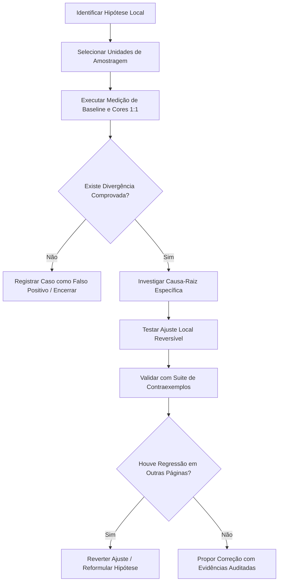

# Projeto Pendente: Auditoria de Métricas Tipográficas e Fidelidade de Cores

- **Status:** INVESTIGAÇÃO EM CURSO POR AMOSTRAS LOCAIS; auditoria global de conversão CMYK/sRGB permanece em backlog.
- **Prioridade:** MÉDIA (Elevar para ALTA se comprovado impacto no Copyfit V3 ou em páginas em certificação)
- **Escopo:** Investigação técnica comparativa entre PDF oficial, Viewer (EN/PT-BR) e PDF exportado nas frentes de microtipografia e fidelidade cromática
- **Área:** Engenharia Tipográfica / Gestão de Cores / QA Visual / Copyfit
- **Diretriz:** *Uma amostra local não autoriza mudança global de renderer, fontes ou perfis de cor. Quando a comparação direta com o PDF OG comprovar um desvio local, corrija a unidade ou moldura afetada, repita Copyfit e valide Viewer/PDF. Registre separadamente hipóteses de alcance global.*

---

## 1. Contexto e Motivação

O projeto Middara Rulebook App tem como premissa a equivalência visual e geométrica estrita em relação ao manual impresso em inglês (102 páginas, v1.2 da Succubus Publishing). 

Durante as fases de localização e aprovação editorial, foram levantadas duas frentes de investigação sobre possíveis microdivergências que merecem uma auditoria técnica aprofundada:
1. **Métricas e Espaçamento Tipográfico:** Como line-height, leading original, distância entre baselines, tracking e avanço de glifos se comportam no motor CSS em comparação com a composição original do Adobe InDesign.
2. **Fidelidade Cromática:** Como cores de texto, fundos pergaminhados, transparências e perfis de cores se comportam na transição PDF Original → Web Canvas/DOM → PDF Exportado.

Esta documentação estrutura as hipóteses, metodologia de medição, componentes envolvidos e critérios para eventual intervenção.

---

## 2. Frente 1: Métricas e Espaçamento Tipográfico

### 2.1. Problema e Hipóteses Técnicas

A hipótese central é que o CSS do navegador e os motores de PDF headless podem introduzir pequenas discrepâncias no posicionamento vertical e horizontal das linhas de texto em relação ao InDesign original.

**Premissa errada a evitar:** Presumir que `line-height: 1.00` ou defaults de navegadores representam com fidelidade a composição original do livro.

As áreas prioritárias de investigação são:

1. **Line-Height e Leading Real do PDF:**
   - No InDesign/PDF original, o *leading* é uma medida explícita (ex.: texto corpo 9.5 pt sobre leading 11.2 pt).
   - No `PageRenderer.tsx`, linhas são renderizadas dentro de blocos usando `lineHeightMode` (`source` vs `custom`) e multiplicadores numéricos.
   - **Ponto a investigar:** Avaliar se o leading original registrado nas caixas de texto do PDF está sendo preservado diretamente ou se há desvios de arredondamento causados pelo modelo de caixa do navegador.

2. **Distância Real entre Linhas de Base (Baselines):**
   - No PDF, a coordenada fundamental de cada linha de texto é a sua **baseline vertical ($Y_0$)**.
   - No CSS do navegador, elementos de bloco fluem a partir do topo do *content-box*, adicionando meio-leading superior e inferior (*half-leading*).
   - **Ponto a investigar:** Medir a distância $\Delta Y = Y_{n+1} - Y_n$ entre as linhas de base reais registradas no `page_XXX_dom.json` (`span.origin[1]` ou `line.bbox[3]`) e compará-las com os nós correspondentes renderizados no DOM.

3. **Letter-Spacing e Avanço dos Glifos (Tracking / Kerning):**
   - O InDesign aplica tabelas de kerning ótico/métrico e tracking por parágrafo (frequentemente ajustado entre `-20` e `+10` milésimos de em para caber em colunas).
   - O `PageRenderer.tsx` possui atualmente uma regra empírica de compensação:
     ```ts
     letterSpacing: hasInlineSymbols && language === 'en' ? 'normal' : '-0.015em'
     ```
   - **Ponto a investigar:** Verificar se `-0.015em` é adequado para todas as famílias ou se produz condensamento excessivo em certas fontes (como `OptimaLTStd` vs `AGaramondPro`), ou se o tracking deve ser extraído das medições do PDF original.

4. **Métricas e Variantes das Fontes:**
   - Comparar métricas verticais (Ascender, Descender, Cap-Height, X-Height, WinAscent/WinDescent) entre as fontes web carregadas em `apps/web/public/fonts/` e as fontes incorporadas no PDF original da editora.
   - Avaliar se fontes com peso incorporado (`OptimaLTStd-Bold`, `OptimaLTStd-DemiBold`) possuem avanços horizontais idênticos aos glifos correspondentes do PDF oficial.

5. **Espaçamento entre Parágrafos e Unidades Tipográficas:**
   - No PDF oficial, títulos, subtítulos e transições de parágrafo contam com espaços verticais dedicados (`spaceBefore` / `spaceAfter`).
   - Investigar se quebras de linha (`\n`) isoladas em blocos fundidos causam acúmulo vertical ou quebras indesejadas.

### 2.2. Impacto no Copyfit V3

Qualquer desvio nas métricas horizontais (letter-spacing / tracking) ou verticais (leading) afeta diretamente o cálculo de quebra de palavras. 
- Um tracking ligeiramente mais largo pode forçar a última palavra de uma linha para a linha seguinte, gerando um falso `OVER` na contagem de linhas do Copyfit V3.
- Um leading divergente pode alterar a ocupação da caixa delimitadora, falseando medições de colisão com ilustrações ou caixas "Important".

### 2.3. Evidências Empíricas da Auditoria (Censo Global de 102 Páginas e Caso Página 17)

Em auditoria realizada em outubro de 2026, foram confrontadas as coordenadas geométricas reais extraídas do PDF original (`page_XXX_dom.json`) contra os dados de renderização e propostas editoriais do aplicativo:

#### A. Censo Global de Leading do PDF Original (102 Páginas, 4.618 Blocos)
A análise computacional das distâncias entre linhas de base consecutivas ($\Delta Y = Y_{n+1} - Y_n$) revelou o padrão exato de composição do Adobe InDesign no livro original:
1. **Corpo de Texto Principal (`OptimaLTStd` 10 pt, $N = 2.539$ transições de linha):**
   - **Leading Mediano:** **11,000 pt exatos** (média: $11,232\text{ pt}$).
   - **Razão de Leading / Tamanho:** **1,10x** a **1,12x**. Em nenhum parágrafo de corpo o PDF original usa razão 1,00x.
2. **Texto Secundário e Barras Laterais (`OptimaLTStd` 8 pt, $N = 164$ transições):**
   - **Leading Mediano:** **9,000 pt exatos** (razão **1,125x**).
3. **Texto em Destaque (`OptimaLTStd-Bold` 10 pt, $N = 20$ transições):**
   - **Leading Mediano:** **12,000 pt exatos** (razão **1,20x**).

#### B. Auditoria do Motor de Renderização e Propostas (PT-BR)
1. **Ausência de Metadados de Leading no DOM:** Dos 4.618 blocos extraídos nas 102 páginas, apenas **1 bloco** possui `defaultLineHeight` gravado e apenas **114 blocos (2,5%)** possuem `layoutFrame.lineHeight`. Os outros **4.503 blocos (97,5%)** não possuem especificação de leading nos metadados.
2. **Fallback para `lineHeight: 1` no `PageRenderer.tsx`:** No renderizador de blocos traduzidos (`BlockRenderer`), quando o bloco não possui `lineHeight` explícito na proposta nem no `layoutFrame`, o motor aplica o fallback:
   ```ts
   const fallbackLineHeight = currentOverride.lineHeight ?? block.defaultLineHeight ?? layoutFrameOverride?.lineHeight
     ?? block.layoutFrame?.lineHeight ?? 1;
   ```
   Isso faz com que o CSS aplique `line-height: 1`. Com `font-size: 10pt`, cada linha ocupa apenas **10,00 pt** de altura vertical.
3. **Distribuição nas Propostas Atuais (`docs/translations/proposals/`, $N = 2.131$ candidatos):**
   - Candidatos com `lineHeight: 1.1`: **1.090 (51,1%)**
   - Candidatos com `lineHeight: 1`: **773 (36,3%)**
   - Candidatos sem `lineHeight` especificado (fallback 1): **157 (7,4%)**
   - Total com `lineHeight: 1.00`: **930 candidatos (43,6%)**

#### C. Estudo de Caso Controlado: Página 17 (Seção "Totens")
Na visualização comparativa da Página 17 entre o original em inglês e a proposta PT-BR:
- **Parágrafo 1 (`block_33`, 9 linhas, `OptimaLTStd` 10 pt):**
  - *Inglês (PDF Original):* Baselines em $Y = 201,97, 212,97, \dots, 289,97$ ($\Delta Y = 11,00\text{ pt}$). Altura do bloco = **99,90 pt**.
  - *PT-BR (`lineHeight: 1`):* 9 linhas $\times 10\text{ pt} = 90,00\text{ pt}$. O bloco fica **9,90 pt mais curto**.
  - O parágrafo 1 em PT-BR termina em $Y = 282,78\text{ pt}$, abrindo uma lacuna artificial de **14,67 pt** até o parágrafo 2 (no original EN essa lacuna é de apenas **4,77 pt**).
- **Parágrafo 2 (`block_34`, 5 linhas, `OptimaLTStd` 10 pt):**
  - *Inglês (PDF Original):* Baselines em $Y = 306,64, \dots, 350,64$ ($\Delta Y = 11,00\text{ pt}$). Altura do bloco = **55,90 pt**.
  - *PT-BR (`lineHeight: 1`):* 5 linhas $\times 10\text{ pt} = 50,00\text{ pt}$. O bloco fica **5,90 pt mais curto**.
  - O parágrafo 2 em PT-BR termina em $Y = 347,45\text{ pt}$. Até o título seguinte ("OBJETIVOS", $Y = 367,50\text{ pt}$), abre-se um espaço vazio de **20,05 pt** (no original EN o espaço é de apenas **14,15 pt**).
- **Conclusão Técnica do Efeito:** O inglês parece "ocupar mais espaço" não porque o texto em inglês seja intrinsecamente mais longo (ambos possuem exatamente 9 e 5 linhas), mas porque o inglês é posicionado pelas coordenadas reais do InDesign com leading de **11,00 pt (1,10x)**, enquanto o PT-BR da Página 17 está condensado verticalmente pelo CSS com `line-height: 1.00`. Ao aplicar `lineHeight: 1.1`, a altura dos blocos PT-BR e o distanciamento até "OBJETIVOS" convergem com precisão milimétrica para a composição original.

#### D. Amostra local de tamanho e cor: página 38 (2026-11-13)

As 35 unidades editoriais da p.38 foram confrontadas com os estilos dos spans do PDF OG, incluindo família, tamanho, cor, peso/itálico e traços. Foi confirmado um desvio local: os três runs de `SP` no bloco PT-BR `page_38_block_9` estavam em Optima Bold 10 pt, enquanto os spans correspondentes no OG usam 9 pt. A correção para 9 pt manteve o copyfit em 7/7 linhas. Nas demais unidades, as combinações de estilo e cores de texto correspondem à fonte. Os dois callouts `IMPORTANTE` são uma reconstrução intencional: o glifo/lettering decorativo original é representado por símbolo semântico e lettering vermelho com contorno branco.

Viewer PT-BR, print e PDF exportado foram comparados visualmente; o PDF exportado passou verificação de página única, MediaBox de 820,346 × 820,346 pt e ausência de caracteres de substituição. Isso demonstra uma correção local e um método de comparação por unidade; não conclui a auditoria global de conversão CMYK/sRGB, fundos, transparências ou todas as famílias tipográficas.

#### E. Amostra local de tamanho, cor e moldura: página 39 (2026-11-14)

As 22 unidades da p.39 foram comparadas ao PDF OG; 124 spans de texto tiveram correspondência geométrica direta e zero falhas de associação. No rich-text final, família, tamanho em pontos, cor, peso e itálico coincidem com os spans da unidade correspondente. Um draft marcava `Derrotaria` como Optima Bold 10 pt, mas o OG usa Optima regular 10 pt em `#231f20`; o peso foi corrigido. O título `Adjacent Spaces` no OG usa Cinzel-Regular 18 pt, branco; a tradução `Espaços Adjacentes` preserva esses atributos.

O proprietário ajustou no editor a moldura PT-BR do título para X=457,631 pt, largura=235,190 pt, altura=24,264 pt e alinhamento central (Payload `layout-frames` id 65). O título mantém 1/1 linha em 100% e 200%. A exportação final EN e PT-BR preservou MediaBox de 820,346 × 820,346 pt e passou `pdfVerification`; as capturas Viewer/print foram comparadas ao OG, sem clipping ou colisão visíveis. A inspeção de `terrain.red-border` e dos callouts IMPORTANT também confirmou que o espaçamento é por ocorrência e que não existe um vão automático universal para `[[symbol]]`.

Esta amostra confirma estilos e geometria locais da p.39. Ela não mede conversão de cor global, perfis ICC, transparências, fundos ou todas as famílias do livro.


#### F. Amostra local de aparência do corpo: página 49 (2026-11-14; diferença ainda sem causa isolada)

Na comparação do raster do PDF OG de 1288×1288 px com Viewer EN e PT-BR, trechos de corpo OptimaLTStd aparentam maior peso no Viewer. Os spans-fonte e os rich-text correspondentes declaram 10 pt/400; a fonte web estava carregada durante a medição, e o mesmo aspecto foi observado na reconstrução EN, portanto a diferença não aponta para uma tradução local. Copyfit da página não apresentou divergência de linha. Não reduzi o peso nos dados PT-BR: a aparência pode envolver o arquivo de fonte local, o programa incorporado no PDF ou rasterização/antialiasing.

**Próxima verificação:** comparar nomes/contornos e métricas do programa Optima incorporado no PDF com `Optima LT Std Roman.otf`, além de capturar os mesmos glifos em PDF OG, Viewer e print a escala 1:1. A causa continua aberta; esta amostra não autoriza mudança global de fonte ou peso. Evidência: `engineering-labs/planning/engineering-decisions/evidence/2026-11-14-p049/post-proof`.
#### G. Amostra repetida de Optima regular: páginas 50 e 59 (2026-11-17; causa ainda aberta)

Na p.59, o corpo OptimaLTStd regular em branco sobre fundo escuro parece mais pesado no Viewer e no print que no raster OG. A divergência aparece tanto na reconstrução EN quanto na página PT-BR; os segmentos PT são `OptimaLTStd`, 10 pt, peso 400, cor `#ffffff`, e o arquivo Roman está carregado. A comparação visual confirmou o contraste; a extração da fonte OG também identifica corpo 10 pt regular. O copyfit das três unidades corrigidas permaneceu igual ao OG (6/6, 5/5 e 4/4). Um registro independente da p.50 já aponta aparência mais pesada do Optima regular no EN do Viewer. Isso reforça a hipótese de uma diferença de fonte/rasterização compartilhada, sem provar qual arquivo ou etapa a causa.

**Próxima verificação:** seguir o plano da amostra F: comparar os contornos e métricas do Optima incorporado no PDF com `Optima LT Std Roman.otf` em glifos idênticos, a escala 1:1, nos três estágios OG/Viewer/print. Não compensar com `font-weight` local nem alterar a fonte global até provar a causa. Evidência p.59: `engineering-labs/planning/engineering-decisions/evidence/2026-11-15-p059-review/correction-2026-11-17/`; evidência p.50 preservada no registro privado dessa página.

---

## 3. Frente 2: Fidelidade das Cores

### 3.1. Problema e Hipóteses Técnicas

A equipe observou percepções de variação de cor entre a visualização do PDF original no Acrobat/Preview, o Viewer no navegador e os arquivos exportados.

**Premissa errada a evitar:** Tratar diferenças de suavização (*antialiasing* de borda de fontes ou interpolação de escala) como divergências reais de cor.

As áreas prioritárias de investigação são:

1. **Cores de Texto e Dark Ink (#231f20):**
   - No manual original, a maior parte do texto "preto" não é `#000000` puro, mas uma tinta rica próxima a `#231f20` (`DeviceCMYK(0, 0, 0, 1)` sobreposta ao pergaminho).
   - Avaliar se o Viewer e o exportador estão aplicando essa cor de forma consistente em todos os spans ou se há trechos herdando `#000` padrão ou cores opacas não intencionais.

2. **Perfis de Cor e Espaços Cromáticos (sRGB vs CMYK):**
   - O manual original impresso utiliza perfis CMYK profissionais (FOGRA39, US Web Coated SWOP v2).
   - Os navegadores web trabalham no espaço de cor sRGB ou Display P3.
   - Na exportação (Puppeteer/PyMuPDF), a rasterização de páginas ou conversão de cores pode causar perda de saturação em tons vermelhos (habilidades/dano) e dourados (títulos).

3. **Fundos Pergaminhados e Modos de Mistura (Blend Modes / Overprint):**
   - No PDF original, textos e florões gráficos podem ter a propriedade de *overprint* ou modo de mesclagem `Multiply` ativados sobre o fundo texturizado.
   - No Viewer web, os fundos de página são servidos como imagens rasterizadas (`page_XXX_background.webp/jpg`). Se a cor de fundo do span não for transparente (`background: transparent`), pode haver caixas brancas ou cinzas cobrindo a textura do papel.

4. **Transparência e Elementos Gráficos:**
   - Tabelas, caixas de diálogo, badges de condições e divisórias que usam opacidade parcial (`opacity` / canais alfa) precisam ser comparadas em fundos controlados.

---

## 4. Metodologia de Investigação e Medição Segura

Para evitar alterações cegas ou ajustes globais arriscados, as investigações futuras devem seguir o seguinte protocolo:



### Amostragem Controlada por Família Tipográfica

A investigação não deve ser feita de forma global nas 102 páginas, mas em 5 casos representativos com contraexemplos fixos:

| Família Tipográfica | Função Editorial | Página de Amostragem | Ocorrência Específica |
| :--- | :--- | :---: | :--- |
| **OptimaLTStd** (400, 700) | Corpo de regras principal | **Pág. 13 / 45** | Bloco de regras de ataque e combate |
| **AGaramondPro** (400, Italic) | Narrativa / Flavour text | **Pág. 02** | Bloco introdutório da história |
| **CinzelLocal** (Small Caps, 700) | Títulos e Banners de seção | **Pág. 14 / 100** | Banner de fases e nomes de cartas |
| **EsmeraldaPro** | Títulos estilizados e números decorados | **Pág. 14 / 25** | Títulos de encontros e fichas de aventureiro |
| **AristelleSans** | Rótulos laterais e legendas técnicas | **Pág. 30 / 102** | Rótulos de diagramas e tabelas de referência |

### Protocolo de Inspeção Cromática

1. **Escala 1:1 Sem Interpolação:** As comparações devem ser realizadas a 100% de escala e com a resolução nativa do PDF (sem zoom interpolado do sistema operacional).
2. **Conta-gotas em Áreas Planas:** As amostras de cor devem ser colhidas no centro dos glifos ou em preenchimentos sólidos, longe das bordas sujeitas ao antialiasing do renderizador.
3. **Ambiente Controlado:** Desativar calibrações de sistema ou filtros de tela (ex.: Night Light, perfis True Tone) durante a tomada de medições.

---

## 5. Critérios para Retomada e Elevação de Prioridade

Esta investigação permanece no backlog como hipótese técnica até que ocorra um dos seguintes gatilhos de ativação:

- [ ] **Gatilho 1 (Copyfit):** Uma proposta de tradução comprovadamente legítima falha no Copyfit V3 (`OVER` por 1 palavra ou poucos pixels) e a análise geométrica demonstra que um tracking ou leading impreciso causou a quebra forçada da linha.
- [ ] **Gatilho 2 (Certificação Visual):** Durante a revisão de páginas finais do lote de publicação, um revisor humano identificar divergência visível de alinhamento vertical com o fundo gráfico da página.
- [ ] **Gatilho 3 (Prévia Gráfica):** A prova de cores em PDF/X ou impressão piloto apresentar dessaturação ou desvio tonal inaceitável em relação ao manual americano.

**Regras de Preservação:**
- Nenhuma tradução humana aprovada no Payload CMS poderá ser sobrescrita por ajustes derivados desta investigação.
- Qualquer alteração tipográfica ou de cores futura deverá ser modular, testada contra o suite de testes de regressão do projeto e 100% reversível.
