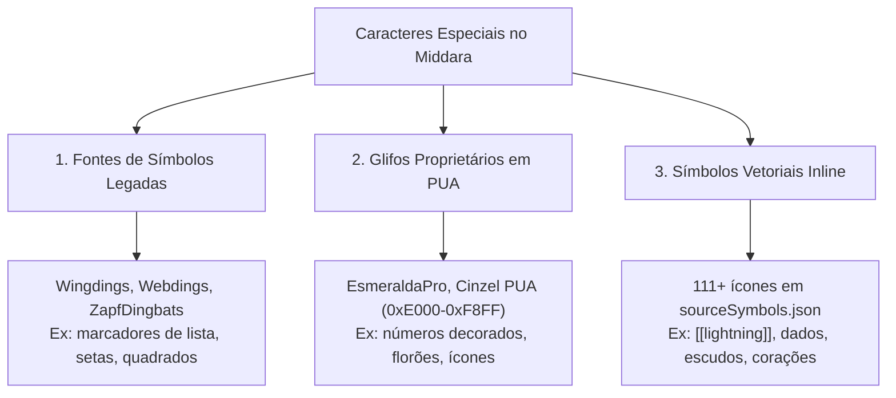
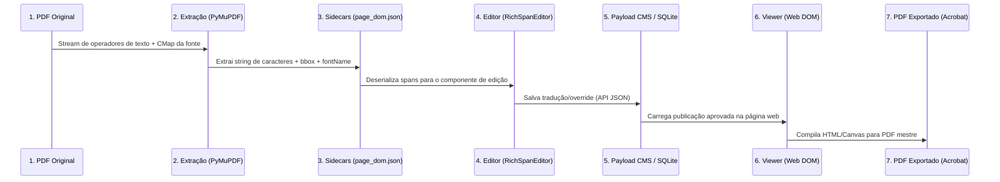
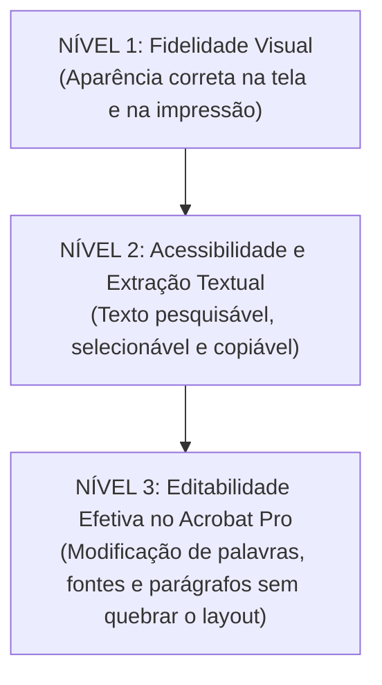

# Projeto Pendente: Caracteres PUA, Fontes Especiais e Editabilidade no Adobe Acrobat Pro

- **Status:** INVESTIGAÇÃO INICIADA / TESTE NO ACROBAT PRO PENDENTE
- **Prioridade:** ALTA (Impacto na Integridade Textual e na Qualidade da Publicação Final em PDF)
- **Escopo:** Investigação técnica ponta a ponta sobre caracteres PUA (*Private Use Area*), fontes simbólicas, causas da ocorrência de quadradinhos (*tofu*) e requisitos para editabilidade profissional do PDF exportado no Adobe Acrobat Pro
- **Área:** Engenharia de Fontes / Codificação Unicode / Pipeline de PDF / Compatibilidade DTP
- **Diretriz Mandatória:** *Não implementar correções agora. Não modificar o renderer, fontes existentes, tabelas de símbolos, esquemas do Payload ou exportador. O objetivo é documentar formalmente o problema, mapear hipóteses e desenhar a estratégia de compatibilidade.*

---

## Evidência inicial do PDF comunitário (22/11/2026)

- O PDF final tem 102 páginas e 40 bookmarks. A extração em lote encontrou 324.468 caracteres, zero `U+FFFD` e zero referências de fontes sem `/ToUnicode`.
- O levantamento encontrou 800 referências `Type3` e 34 `Type0` no conjunto de páginas; são referências por página, não uma contagem de famílias únicas. Nenhuma página tem widget de formulário.
- Isso confirma texto extraível/pesquisável, não a capacidade de editar texto e refluir parágrafos pelo Acrobat. O Acrobat Pro não está instalado neste ambiente, então o Nível 3 continua sem verificação.
- Próximo passo: testar uma cópia do PDF no Acrobat Pro em amostras de texto puro, texto misto, símbolo inline e acentuação PT-BR. Não alterar o renderer ou as fontes até registrar o resultado real do Acrobat.

---

## 1. Problema Observado

Durante o ciclo de localização, aprovação editorial e exportação de páginas, foi observado que **certos caracteres especiais e glifos simbólicos passam a ser renderizados como "quadradinhos" (conhecidos tecnicamente como *tofu*, `.notdef` ou substitutos `\uFFFD`)** em etapas posteriores à tradução, na visualização de blocos aprovados ou no PDF exportado.

**Premissa errada a evitar:** Não assumir que todo quadradinho é simplesmente consequência de uma "fonte ausente no sistema".

A cadeia de dados do Middara passa por múltiplas transformações e serializações. Uma perda de caractere pode se originar em diferentes pontos: mapeamento de codificação, truncamento de strings, divergência de CMap, perda de rich spans, sanitização de banco de dados ou ausência de tabelas `/ToUnicode` na exportação.

---

## 2. Anatomia dos Caracteres Especiais no Projeto Middara

O manual do Middara faz uso intensivo de três categorias de caracteres que fogem do conjunto ASCII/Latin padrão:



1. **Fontes de Símbolos Legadas (Dingbats):**
   - Fontes como `Wingdings`, `Wingdings 3`, `Webdings` e `ZapfDingbats` não utilizam mapeamentos Unicode universais. Em `Wingdings`, por exemplo, a letra `l` (código `0x6C`) é desenhada como uma esfera preta `●`, e a letra `n` (código `0x6E`) é um quadrado preto `■`.
   - Se o navegador ou o leitor de PDF interpretar o caractere com a fonte padrão (`Optima` ou `Inter`), ele exibe a letra `l` ou `n` literal, ou um quadradinho se o byte for tratado como glifo não mapeado.

2. **Área de Uso Privado Unicode (PUA - `U+E000` a `U+F8FF`):**
   - Fontes de alta tipografia como `EsmeraldaPro` utilizam a PUA para armazenar numerais estilizados em círculos, ligaduras especiais e runas do jogo.
   - O projeto possui o arquivo [`apps/web/src/assets/pua_mapping.json`](../../apps/web/src/assets/pua_mapping.json) mapeando códigos PUA para nomes de glifos.
   - **Risco:** Pontos de código PUA não possuem significado padronizado fora daquela fonte específica. Se o renderizador ou o software externo aplicar outra fonte, o caractere perde seu significado visual e textual.

3. **Símbolos Vetoriais Inline (Semantic Symbols):**
   - Ícones de mecânica do jogo (dados, corações de HP, escudos de defesa, crânios de perigo) foram catalogados em [`apps/web/src/symbols/sourceSymbols.json`](../../apps/web/src/symbols/sourceSymbols.json) e renderizados como componentes SVG via [`SemanticSymbol.tsx`](../../apps/web/src/symbols/SemanticSymbol.tsx).
   - No fluxo de texto do editor, esses símbolos utilizam um caractere marcador de substituição de objeto (`SYMBOL_OBJECT_MARKER = '\uFFFC'`) ou tokens textuais como `[[lightning]]`.

---

## 3. Rastreamento da Cadeia de Pipeline: Onde o Caractere se Perde?

Para diagnosticar a causa-raiz dos quadradinhos, a investigação futura deve rastrear o ciclo de vida do caractere em **sete etapas consecutivas**:



### Detalhamento das 7 Etapas e Pontos de Falha

| Etapa | Operação Realizada | Possível Causa do "Quadradinho" |
| :--- | :--- | :--- |
| **1. PDF Original** | Definição de fontes com subconjuntos (*subsetting*) e tabelas CMap. | O PDF oficial pode embutir apenas os glifos usados, sem CMap ToUnicode para caracteres PUA. |
| **2. Extração** | Leitura de texto via PyMuPDF/pdfplumber. | O extrator substitui bytes não decodificáveis por `?` ou códigos incompatíveis. |
| **3. Sidecars** | Geração e armazenamento de `page_XXX_dom.json`. | Conversão inadequada de caracteres de controle ou escape incorreto de sequências hexadecimais em JSON. |
| **4. Editor** | Edição de texto no navegador (`textarea` / contentEditable). | A fonte aplicada na interface administrativa não cobre o glifo PUA, exibindo tofu na tela do usuário, o que leva o editor humano a deletar o caractere por engano. |
| **5. Aprovação / Persistência** | Envio via API REST para o Payload CMS e gravação no banco SQLite. | Normalização de strings Unicode (ex.: conversão forçada NFC/NFD) que remove ou altera caracteres da PUA, ou perda de segmentos ricos (`segments`) convertidos em string plana sem estilos. |
| **6. Viewer Web** | Renderização com CSS `@font-face` e componentes React. | A regra CSS aplica uma família tipográfica genérica (`Optima`) em um segmento que dependia de `Wingdings` ou `EsmeraldaPro-PUA`. |
| **7. PDF Exportado** | Geração de PDF via Chromium headless / PyMuPDF. | As fontes OpenType embutidas no PDF final não contêm o subconjunto correto de glifos, ou a tabela `/ToUnicode` do PDF é omitida, fazendo o Acrobat Pro exibir o caractere substituto. |

---

## 4. Editabilidade no Adobe Acrobat Pro: Os Três Níveis

Um dos requisitos de longo prazo do projeto é assegurar que o PDF exportado pelo Middara Rulebook App possa ser aberto e editado no **Adobe Acrobat Pro** por designers, revisores ou terceiros, sem dependência exclusiva da interface do aplicativo.

É essencial distinguir com rigor os **três níveis de fidelidade** de um documento PDF:



### Nível 1: Aparência Visual Correta (Visual Parity)
- O PDF abre no visualizador e todos os textos, pesos, negritos, itálicos e símbolos aparecem no lugar certo.
- *Limitação:* Isso pode ser obtido até convertendo texto em curvas vetoriais (*outlines*) ou rasterizando, o que destrói a editabilidade. **Não é suficiente para nosso projeto.**

### Nível 2: Extração Textual Correta (Searchable & Accessible)
- O usuário consegue selecionar o texto com o cursor, copiar e colar no Bloco de Notas ou Word, e o texto colado faz sentido linguístico (não vira uma sequência de caracteres corrompidos).
- *Requisito:* Exige que toda fonte embutida no PDF possua uma tabela **`/ToUnicode` CMap** válida, mapeando cada Glyph ID para um ponto de código Unicode padrão.

### Nível 3: Editabilidade Efetiva no Acrobat Pro (True Document Editability)
- O usuário abre o PDF no Adobe Acrobat Pro, seleciona a ferramenta **"Editar PDF"**, clica em uma palavra e consegue:
  1. Digitar novos caracteres mantendo exatamente a mesma família tipográfica, tamanho e peso.
  2. Apagar palavras e observar o parágrafo refluir naturalmente.
  3. Aplicar negrito ou itálico sem que o software troque a fonte por `Arial` ou `Times New Roman`.
  4. Preservar o alinhamento de símbolos adjacentes sem que o parágrafo seja fraturado em caixas soltas.

### Obstáculos Técnicos para o Nível 3 no Acrobat Pro:
1. **Subconjuntos de Fontes Restritos (*Font Subsetting*):** Se o PDF embutir apenas as letras presentes no texto (ex.: `ABCDEF+OptimaLTStd`), quando o usuário tentar digitar uma letra nova no Acrobat (ex.: a letra `Ç` ou `W`), o Acrobat exibirá o erro: *"A fonte original não está disponível no sistema e não pôde ser usada para adicionar novos caracteres."*
2. **Restrições de Licenciamento de Fontes nos Metadados (`fsType`):** Fontes TrueType/OpenType possuem uma flag no cabeçalho OS/2 chamada `fsType` (Embedding Restrictions). Se a fonte proibir "Editable Embedding" (permitindo apenas "Print and Preview"), o Acrobat bloqueia edições de texto por terceiros.
3. **Fracionamento de Caixas por Símbolos Gráficos:** Se um símbolo inline for embutido como uma imagem vetorial solta (XObject), o Acrobat interpreta que o texto antes do símbolo e o texto depois do símbolo pertencem a caixas de texto distintas, quebrando a continuidade da edição do parágrafo.

---

## 5. Estratégias Técnicas Candidatas

A investigação futura deverá avaliar quatro estratégias, analisando seus trade-offs sem escolher uma solução precipitadamente:

| Estratégia | Descrição | Vantagens | Desvantagens / Riscos |
| :--- | :--- | :--- | :--- |
| **A. Unicode Padronizado Semântico** | Mapear caracteres PUA e Dingbats para seus pontos de código Unicode padrão equivalentes (ex.: `U+25A0` para quadrado, `U+2022` para bullet, símbolos de dados Unicode). | - Universalidade de cópia/cola.<br/>- Compatível com qualquer leitor e fonte padrão.<br/>- Elimina a dependência de PUA proprietária. | - Glifos proprietários do jogo (runas, brasões) não existem no padrão Unicode.<br/>- Risco de renderização com visual genérico diferente da arte da editora. |
| **B. Incorporação Completa de Fontes com /ToUnicode** | Embutir a família tipográfica completa (ou subset ampliado com todo o alfabeto latino estendido PT-BR) no PDF gerado, com mapas `/ToUnicode` rigorosos. | - Permite digitação de qualquer letra em português no Acrobat Pro.<br/>- Garante fidelidade visual e textual simultâneas. | - Aumenta o tamanho final do arquivo PDF.<br/>- Requer verificação das licenças das fontes (`Optima`, `Cinzel`, `Garamond`, `Esmeralda`). |
| **C. Fonte de Ícones OpenType Dedicada (MiddaraIconFont)** | Compilar os 111+ símbolos mecânicos do projeto em um arquivo de fonte OpenType (`.otf` / `.woff2`) com glifos vetoriais e mapa PUA documentado. | - Símbolos passam a ser tratados como texto verdadeiro.<br/>- O Acrobat Pro preserva o parágrafo contínuo sem fracionar caixas de texto.<br/>- Permite redimensionamento e cor automáticos via estilo de fonte. | - Exige pipeline de compilação de fonte vetorial.<br/>- Símbolos multicoloridos exigem fontes OpenType-SVG ou COLR/CPAL, com suporte variável em softwares antigos. |
| **D. Abordagem Híbrida Texto-Contínuo + Inline XObjects** | Manter o texto puro como texto editável e ancorar símbolos complexos como formulários gráficos XObject com atributos estruturados de marcação PDF (*Tagged PDF / Structure Tree*). | - Suporta símbolos policromáticos de alta complexidade gráfica.<br/>- Não altera as fontes de texto do projeto. | - O Acrobat Pro pode não conseguir refazer o fluxo do parágrafo ao redor do objeto durante edições manuais. |

---

## 6. Matriz de Compatibilidade e Casos de Teste Futuros

Quando a investigação for retomada, a validação técnica deverá ser executada contra uma matriz de **6 casos representativos**:

```
[Caso 1: Texto Comum Puro] ────► OptimaLTStd Regular, sem decorações
[Caso 2: Texto Misto B/I]  ────► Trechos alternando Regular, Bold e Italic
[Caso 3: Caractere PUA]    ────► Numeral estilizado em EsmeraldaPro-PUA
[Caso 4: Símbolo Simples]  ────► Marcador/ícone monocromático derivado de Dingbats
[Caso 5: Texto com Ícones] ────► Parágrafo contínuo com múltiplos símbolos inline ([[lightning]], HP, etc.)
[Caso 6: Tradução Aprovada]────► Bloco salvo e publicado via Payload com acentuação PT-BR e edição humana
```

### Critérios de Avaliação por Ambiente:

| Critério de Teste | PDF Original | Viewer Web (DOM) | PDF Exportado | Adobe Acrobat Pro |
| :--- | :---: | :---: | :---: | :---: |
| **1. Visualização sem Tofu:** Nenhum quadradinho ou substituto visível | Mandatório | Mandatório | Mandatório | Mandatório |
| **2. Seleção de Texto:** O cursor do mouse seleciona o texto linearmente | Sim | Sim | Sim | Sim |
| **3. Cópia e Cola:** O texto colado em editor externo mantém acentuação e ordem | Sim | Sim | Sim | Sim |
| **4. Edição de Palavras:** O usuário digita uma palavra nova sem erro de fonte | N/A | Sim (no App) | N/A | **Alvo a Comprovar** |
| **5. Preservação de Estilo:** O negrito e a família persistem após edição | N/A | Sim | N/A | **Alvo a Comprovar** |
| **6. Refluxo de Parágrafo:** Adicionar texto empurra as linhas sem sobreposição | N/A | Sim | N/A | **Alvo a Comprovar** |

---

## 7. Dependências e Posição no Backlog

- **Dependências Técnicas:**
  - [Projeto Concluído 11: Exportador do Livro Completo em PDF](../concluidos/11-exportador-do-livro-completo-em-pdf.md).
  - [Projeto Pendente 05: Saída para Gráfica (CMYK, PDF/X e Preflight)](05-saida-para-grafica-cmyk-pdfx-preflight.md).
- **Prioridade e Momento de Execução:**
  - Esta investigação deve ser iniciada **após a estabilização do motor de exportação de PDF mestre**, mas **antes da certificação final de impressão e distribuição digital do livro**.
- **Meta Final do Roadmap:**
  - Produzir PDFs visualmente fiéis ao original da Succubus Publishing, textualmente pesquisáveis e acessíveis, e com o maior grau de editabilidade externa possível no Adobe Acrobat Pro, garantindo a sustentabilidade e longevidade do livro em português.
