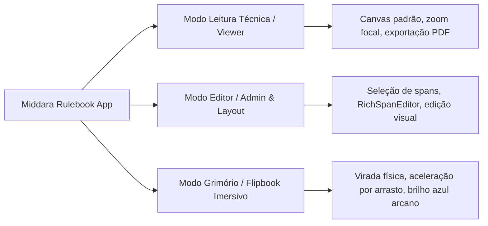
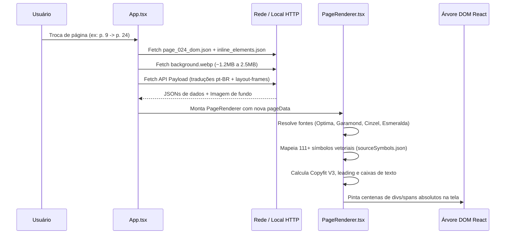
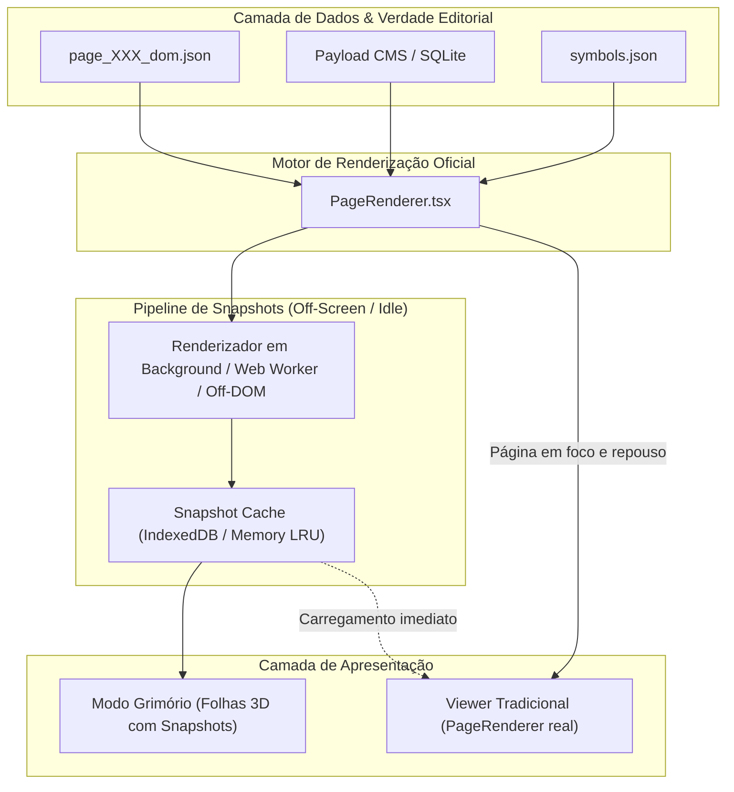
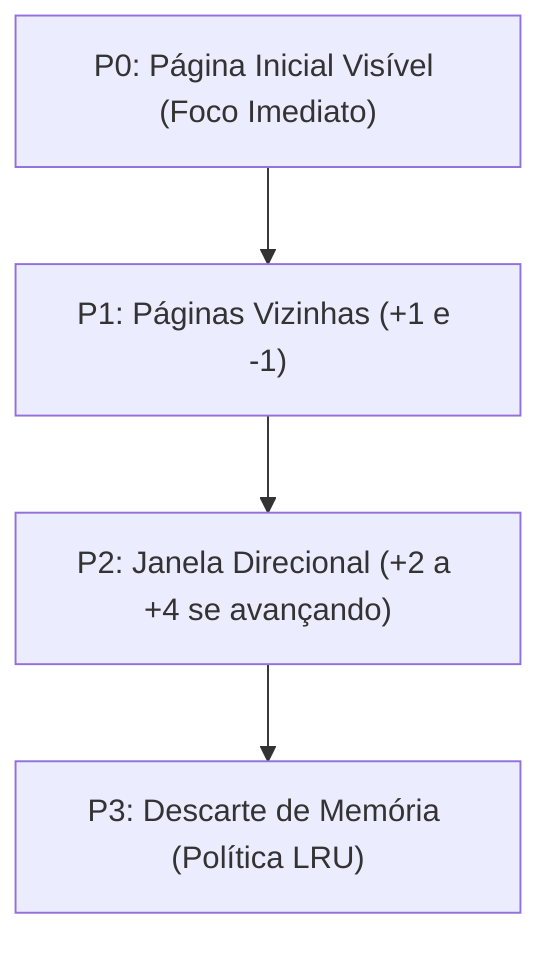
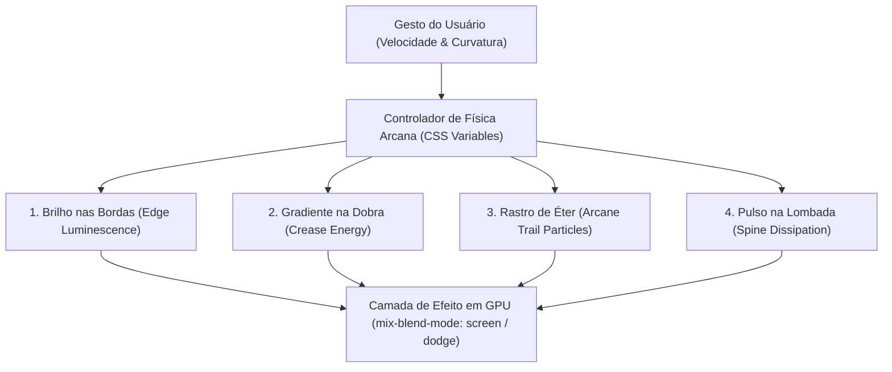
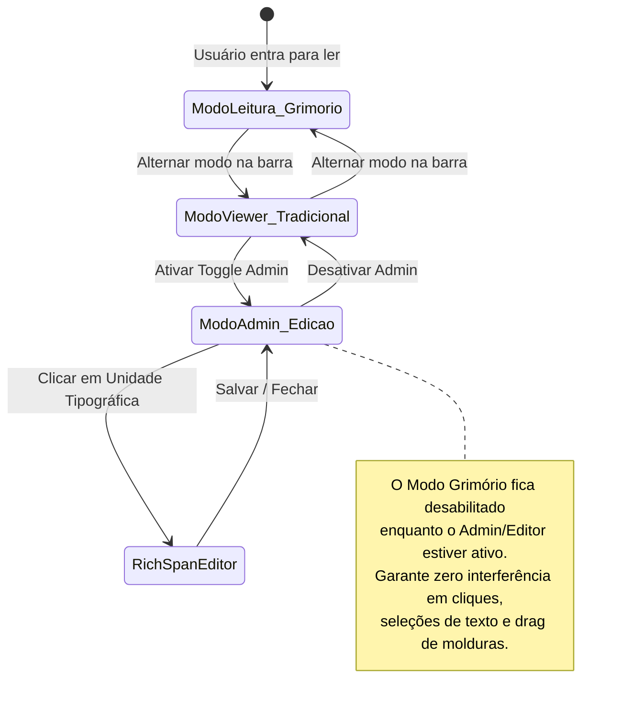
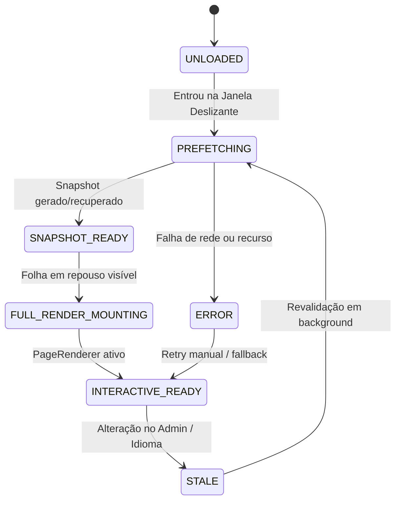

# Projeto Pendente: Modo Grimório, Pré-renderização Inteligente e Efeitos Arcanos

- **Status:** BACKLOG / DESIGN ARQUITETURAL E EXPERIÊNCIA DE LEITURA
- **Prioridade:** MÉDIA (Evolução de Experiência / Não Bloqueante para a Conclusão Editorial das 102 Páginas)
- **Escopo:** Especificação técnica e arquitetural de um modo de leitura imersivo inspirado em um grimório físico com virada física de páginas, scrub acelerado, pré-renderização em cache, renderização reativa de efeitos mágicos azuis e integração não-destrutiva com o Viewer tradicional, o Block Editor e o exportador de PDF
- **Área:** Frontend / Animação / Performance & Cache / UX & Efeitos Visuais / Acessibilidade
- **Diretriz Mandatória:** *Não implementar agora. Não instalar dependências (ex.: `@gul-labs/flipbook` ou afins). Não alterar componentes de produção ([PageRenderer.tsx](file:///c:/Users/bruno/Middara/Rulebook%20App/apps/web/src/components/PageRenderer.tsx), [App.tsx](file:///c:/Users/bruno/Middara/Rulebook%20App/apps/web/src/App.tsx)). Não interromper o cronograma de localização e aprovação editorial das páginas 13 a 102. Este documento tem por finalidade guiar a engenharia quando a prioridade de tradução e impressão gráfica for concluída.*

---

## 1. Visão de Produto e Filosofia da Experiência

O projeto Middara Rulebook App já consolidou uma base de dados milimétrica, réplica fiel do manual de 102 páginas, com renderização de fontes autênticas, caixas de layout vetoriais e persistência editorial. A etapa de leitura e navegação, contudo, é hoje estruturada em um modelo de visualizador linear baseado em scroll ou troca discreta de páginas.

A visão do **Modo Grimório** é transformar a consulta ao livro em uma experiência tátil, elegante e sobrenatural:

> *"O leitor não deve interagir com uma planilha de dados ou um PDF frio, mas com um tomo antigo de fantasia que responde ao toque e ao movimento com física orgânica e energia arcana — sem jamais sacrificar a precisão técnica e a integridade tipográfica."*

### O Princípio Fundamental: "Primeiro Rápido, Depois Físico, por Fim Magia"
1. **Desempenho antes de cosmética:** Nenhum efeito visual ou animação será implementado para mascarar gargalos de rede ou compilação de layout.
2. **Separação estrita:** A física e os efeitos de luz são camadas puras de apresentação; a fonte da verdade continua sendo o DOM semântico, os dados do Payload e o catálogo de símbolos.
3. **Equilíbrio estético:** O brilho mágico deve remeter à identidade visual da capa do Middara (tons azuis arcanos, suaves e integrados às sombras do papel), e não a uma interface estéreo de videogame neon.

---

## 2. Diagnóstico de Performance: Onde Estão os Gargalos Atuais?

Antes de acoplar qualquer biblioteca de animação física, a arquitetura deve separar a *latência de renderização* da *animação de transição*.

### Mapeamento dos Gargalos Atuais do Viewer

### Análise Causal dos Tempos de Espera:
1. **Ativos de Imagem (Background WebP):** Cada página do manual é um scan/render de alta definição (entre 1.000 e 2.500 KB). Na ausência de cache em memória ou requisições paralelas antecipadas, o browser precisa esperar a decodificação da textura de fundo.
2. **Carga em Cascata de JSONs:** O carregamento da página envolve `page_XXX_dom.json`, `inline_elements.json` e, dependendo do estado, requisições de API ao Payload para buscar registros de tradução.
3. **Custo de Montagem do React:** O [PageRenderer.tsx](file:///c:/Users/bruno/Middara/Rulebook%20App/apps/web/src/components/PageRenderer.tsx) compõe até 80 blocos de texto por página, dezenas de spans tipográficos, injeção de SVGs via `SemanticSymbol.tsx` e cálculo de limites com `getBoundingClientRect()` nos hooks de medição.
4. **Resolução de Fontes na Abertura Fria:** Se uma variante (como `Cinzel Decorative` ou `OptimaLTStd-Bold`) ainda não foi baixada ou decodificada pelo `document.fonts`, ocorre um relayout visual (*layout shift* ou breve flash).

**Conclusão Técnica:** O Modo Grimório **não pode** montar duas ou mais instâncias completas do `PageRenderer` interativo simultaneamente para cada folha em trânsito. A virada física precisa operar sobre **snapshots visuais pré-compostos e leves**, substituindo pelo `PageRenderer` completo somente no repouso da folha ativa.

---

## 3. Arquitetura de Pré-renderização e Snapshots Visuais Inteligentes

Para garantir que a virada de página seja instantânea (60 fps estáveis), propõe-se uma arquitetura baseada em **Snapshots Visuais Não-Destrutivos**.

### Características dos Snapshots:
- **Origem Única:** Os snapshots não são gerados por um segundo motor gráfico alternativo. Eles são capturados a partir da própria árvore do `PageRenderer` compilada pelo navegador (via `ImageBitmap`, SVG encapsulado ou Canvas offscreen), garantindo fidelidade pixel-a-pixel com o texto real.
- **Resolução Proporcional ao Caso de Uso:**
  - *Snapshots de Alta Definição:* Para as páginas esquerda/direita em leitura no livro aberto.
  - *Thumbnails de Baixa Resolução / Folhear Acelerado:* Snapshots compactados (ex.: 25% da resolução nativa, ~50KB) para movimentação rápida de múltiplas folhas sem sobrecarga de GPU.
- **Identidade Estrita e Invalidação (Cache Key):**
  A chave de cada snapshot deve garantir integridade e invalidação imediata após edições:
  $$\text{CacheKey} = \text{pageNumber} + \text{"\_\_"} + \text{language} + \text{"\_\_"} + \text{hash(override + layoutFrame + symbolsRevision)}$$
  Se um usuário aprovar uma tradução, editar um span ou ajustar uma moldura no Admin, o snapshot é descartado imediatamente. **Nunca apresentar um snapshot obsoleto como se fosse o estado oficial.**

---

## 4. Estratégia de Pré-carregamento: Janela Deslizante Reativa

A memória do dispositivo do usuário (seja um desktop ou tablet na mesa de jogo) não deve ser sobrecarregada com 102 páginas completas. Adota-se o modelo de **Janela Deslizante Preditiva**.

### Níveis de Prioridade de Carregamento

1. **Abertura da Sessão (Página Inicial):**
   - **Abertura Fria:** Carrega com prioridade máxima o WebP da capa ou página 1, fontes básicas (`OptimaLTStd`, `Cinzel`) e dispara a hidratação textual. Uma transição sutil em opacidade evita sobressaltos.
   - **Abertura Quente:** Se o snapshot da página 1 já estiver presente no cache local (IndexedDB), ele surge em menos de 50ms enquanto a árvore interativa inicializa em segundo plano.
2. **Janela Deslizante Adaptativa:**
   - Estando o usuário na página **P**:
     - *Repouso:* O sistema prepara em background $P+1$ e $P-1$.
     - *Navegação Contínua para Frente:* O prefetcher detecta o vetor positivo de navegação e antecipa $P+1$, $P+2$ e $P+3$.
     - *Navegação para Trás:* Inverte a prioridade para $P-1$, $P-2$.
   - **Capacitores de Memória (LRU):** O cache retém no máximo 6 a 8 páginas completas em memória simultaneamente, descartando as mais distantes quando o limite de orçamento é atingido.

---

## 5. Avaliação Técnica da Biblioteca de Referência (`gul-labs/flipbook`)

A referência técnica apresentada pelo usuário é o repositório [`gul-labs/flipbook`](https://github.com/gul-labs/flipbook) (e sua variante React `@gul-labs/react-flipbook`).

### Diagnóstico de Compatibilidade Arquitetural:

| Critério | Situação no `gul-labs/flipbook` | Solução Arquitetural do Middara |
| :--- | :--- | :--- |
| **Arquitetura de Páginas** | Opera sobre elementos HTML DOM estruturados em páginas pares/ímpares. | Compatível: os snapshots ou containers de página são divs HTML dimensionadas. |
| **Renderização e Zoom** | Transforma o container com CSS 3D (`transform`, `rotateY`, `perspective`). | Exige isolamento: durante a virada o zoom deve travar; após a parada, reativa o zoom focal. |
| **Duas Páginas vs Uma Página** | Suporta modo spread (2 páginas lado a lado em desktop) e portrait (1 página em telas móveis). | Perfeito para o formato quadrado do Middara (820.35pt $\times$ 820.35pt por página). |
| **Modificações de Estado React** | Atualizações frequentes de props recriam instâncias do motor. | Requer isolamento total via `React.memo` e referências imperativas (`ref`). |
| **Licenciamento** | Motor central: **MPL-2.0** (*Mozilla Public License 2.0*); Wrapper React: **MIT**. | Permissivo para uso no projeto, desde que modificações no próprio motor sejam documentadas. |

### Regra de Ouro: Desacoplamento Absoluto
O `PageRenderer.tsx` **não deve ser refatorado** para depender do flipbook. O flipbook é um invólucro opcional da casca do aplicativo ([App.tsx](file:///c:/Users/bruno/Middara/Rulebook%20App/apps/web/src/App.tsx)). O leitor poderá alternar livremente entre:
- **Modo Tradicional:** Visualizador técnico atual com zoom focal livre, pan e modo contínuo.
- **Modo Grimório:** Visualização em livro encadernado de 2 páginas com física de dobra.

---

## 6. Navegação Acelerada: O Gesto de Folhear Múltiplas Folhas (*Scrubbing*)

Um livro físico não é navegado virando uma página de cada vez quando se deseja ir da página 14 para a página 78. O leitor passa o polegar pelas bordas e folheia velozmente dezenas de folhas.

### Mecânica de Execução:
1. **Desacoplamento Visual vs Lógico:**
   - Se o usuário arrasta o controle de folhear da página 10 para a 50, o sistema **não agenda 40 viradas completas de página** (o que travaria a thread gráfica e provocaria engasgos de lixo de memória).
   - O motor executa uma animação contínua de "leque de folhas" com sombras móveis e rastro de páginas comprimidas.
   - O conteúdo central exibe rapidamente snapshots de baixa resolução ou uma visualização panorâmica de seções (*preview strip*).
2. **Chegada e Desaceleração:**
   - Ao soltar o cursor ou dedo, a animação desacelera organicamente em direção à página de parada calculada.
   - A página de destino tem sua prioridade de carga elevada para P0.
   - A folha final estabiliza na horizontal e o conteúdo textual real assume o lugar do snapshot sem interrupções perceptíveis.

---

## 7. Efeitos Arcanos: Iluminação Azul Mágica Reativa

Inspirado nas runas e na atmosfera visual da capa do Middara, o grimório reage à física do manuseio com energia arcana.

### Detalhamento dos Componentes Visuais:

#### A. Luminescência das Bordas e Dobras
- Conforme a folha levanta e dobra no eixo Z, uma sutil linha de luz azul surge exatamente no vértice de curvatura da folha.
- **Implementação Leve:** Utilização de pseudo-elementos (`::after`) com gradientes lineares cianita/anil e filtros leves (`box-shadow`, `mix-blend-mode: screen`), sem recorrer a shaders WebGL pesados.
- Não há incidência de luz ou reflexos fortes sobre a mancha gráfica de texto para não prejudicar a legibilidade.

#### B. Intensidade Dinâmica Reativa à Velocidade
- A intensidade luminosa é mapeada em função direta da velocidade angular da virada:
  $$\text{Opacidade} = \text{clamp}(0.1, \;\text{velocidade} \times K, \;0.85)$$
- **Virada lenta:** Brilho quase imperceptível, como poeira mágica sob a dobra.
- **Folhear rápido:** Aumento progressivo de brilho nas extremidades externas das páginas em trânsito.
- **Amortecimento (Lerp):** Interpolação suave na desaceleração, evitando cintilações (*strobing*).

#### C. Rastro Arcano e Pulso na Lombada
- **Rastro:** Durante navegações com alta velocidade de travessia, 3 a 5 partículas leves de éter azul flutuam brevemente atrás da borda que se move, dissipando-se em menos de 400ms.
- **Pulso na Lombada:** Ao encerrar o gesto e assentar a última página, a luz residual percorre o centro do livro (lombada) e se extingue com um sutil fade-out, como se o livro absorvesse o excesso de mana.

#### D. Acessibilidade e Configuração
- Total respeito à diretriz de acessibilidade `@media (prefers-reduced-motion: reduce)`: neste modo, as viradas 3D e rastros são substituídos por cross-fades discretos.
- Interruptor dedicado nas preferências do aplicativo para desativar efeitos arcanos mantendo a virada física, ou vice-versa.
- **Regra de Exportação:** Nenhum elemento arcano, sombra artificial ou overlay dinâmico é incluído no exportador de PDF ([export_page_pdf.mjs](file:///c:/Users/bruno/Middara/Rulebook%20App/scripts/export_page_pdf.mjs)).

---

## 8. Integração com a Pesquisa Global e Navegação Semântica

A busca textual por termos de regras, disciplinas, itens ou palavras-chave (conforme padronizado no Glossário Canônico) integra-se de forma inteligente ao folhear visual:

1. **A Busca Opera Sobre o Texto Canônico:** O motor de busca jamais pesquisa texto em imagens ou OCR de snapshots. O índice de busca lê diretamente as strings de tradução do banco e os termos do glossário.
2. **Navegação com Salto Curto vs Salto Longo:**
   - *Resultado a 1 ou 2 páginas de distância:* O Grimório executa a animação natural de virada física de folha acompanhada pelo brilho azul.
   - *Resultado a mais de 3 páginas:* O Grimório executa a animação de passagem acelerada de múltiplas páginas (*scrub*) e pousa diretamente na página-alvo.
3. **Destaque do Termo no Destino:**
   - Ao pousar na página de destino e carregar o `PageRenderer` interativo, a unidade editorial encontrada recebe o pulso de destaque (*review highlight* ou marcador dourado) já existente no sistema, garantindo clareza instantânea para o jogador na mesa.

---

## 9. Proteção e Isolamento do Block Editor e Admin

A integridade do fluxo de tradução e revisão é um princípio inviolável do projeto.

- **Incompatibilidade Intencional com Edição Concorrente:** Não se deve editar texto rico nem manipular molduras de layout enquanto a página estiver inclinada em rotação tridimensional de 45 graus.
- Ao acionar o botão `Admin` no painel superior/lateral, o aplicativo suspende o container do flipbook e estabelece a visualização bidimensional plana do `PageRenderer`.
- Ao fechar o Admin ou sair da edição, o leitor pode retornar ao Grimório, momento em que o snapshot daquela página é reconstruído com as novas modificações aprovadas.

---

## 10. Matriz de Estados de Ciclo de Vida da Página

Para assegurar uma interface robusta sem travas ou inconsistências, cada página no Modo Grimório percorrerá os seguintes estados bem definidos:

| Estado | Significado | Comportamento Visual |
| :--- | :--- | :--- |
| **`UNLOADED`** | Página fora do raio de interesse da janela deslizante. | Sem alocação de memória ou ativos em cache. |
| **`PREFETCHING`** | Carregamento assíncrono de dados e geração do snapshot offscreen. | Transparente ao usuário (background ocioso). |
| **`SNAPSHOT_READY`** | Snapshot visual presente em cache pronto para animação física. | Folha pode virar e se dobrar a 60 fps imediatamente. |
| **`FULL_RENDER_MOUNTING`** | Folha assentou na mesa; o `PageRenderer` real é acoplado. | Cross-fade imperceptível entre snapshot e DOM interativo. |
| **`INTERACTIVE_READY`** | Página pronta para seleção, zoom focal, inspeção e links. | Funcionalidade completa idêntica ao Viewer. |
| **`STALE`** | Tradução foi editada ou layout alterado. | Invalidação do snapshot anterior; agenda regeneração. |
| **`ERROR`** | Ativo corrompido ou falha de conectividade com a API. | Notificação contextual discreta com botão de nova tentativa. |

---

## 11. Orçamento de Performance e Limites de Recursos

A engenharia futura deverá cumprir o seguinte **Orçamento de Recursos (Performance Budget)**:

| Métrica | Meta em Desktop Médio | Meta em Dispositivo Móvel / Tablet |
| :--- | :--- | :--- |
| **Taxa de Quadros da Virada (FPS)** | 60 fps contínuos | 60 fps (mínimo tolerável 50 fps) |
| **Tempo até 1ª Página (Abertura Quente)** | $\le$ 80 ms | $\le$ 150 ms |
| **Tempo até 1ª Página (Abertura Fria)** | $\le$ 800 ms | $\le$ 1.500 ms |
| **Latência de Virada de Página (Cache)** | $\le$ 16 ms (1 frame) | $\le$ 32 ms |
| **Consumo de Memória do Cache (LRU)** | $\le$ 120 MB | $\le$ 60 MB |
| **Número Máx. de Páginas em Memória** | 8 páginas completas | 4 páginas completas |
| **Custo de Renderização dos Efeitos** | $\le$ 2 ms por frame (GPU) | $\le$ 3 ms por frame (GPU) |
| **Invalidação de Cache após Edição** | Imediata (tempo de descarte $\le$ 5ms) | Imediata ($\le$ 10ms) |

---

## 12. Roteiro de Implementação Incremental (Fases 1 a 6)

A execução deste projeto deve ser dividida em seis etapas sequenciais independentes, garantindo validação a cada marco:

### Fase 1 — Diagnóstico de Performance e Instrumentação
- Medir tempos reais de renderização do [PageRenderer.tsx](file:///c:/Users/bruno/Middara/Rulebook%20App/apps/web/src/components/PageRenderer.tsx) página a página (da 1 à 102).
- Mapear quais páginas possuem maior peso de DOM (ex.: páginas com dezenas de símbolos ou tabelas complexas).
- Instrumentar métricas de memória e decodificação de WebP.
- *Nenhuma animação ou dependência é adicionada nesta fase.*

### Fase 2 — Infraestrutura de Cache e Snapshots Visuais
- Criar o subsistema de captura de snapshots via pipeline off-screen oficial.
- Implementar o repositório em cache local (IndexedDB) com política LRU de 6 a 8 páginas.
- Implementar a chave de cache determinística com invalidação automática em caso de salvamento editorial.
- Testar e validar a troca imperceptível *Snapshot $\rightarrow$ PageRenderer* no próprio Viewer tradicional.

### Fase 3 — Navegação Acelerada e Janela Deslizante
- Implementar o controle de scrub/arrasto rápido na barra de navegação sem acoplamento 3D.
- Validar a lógica de prefetching direcional (vetor frente/trás).
- Garantir que grandes saltos (ex.: p. 9 $\rightarrow$ p. 75) não disparem carregamentos intermediários desnecessários.

### Fase 4 — Piloto do Modo Grimório (Física 3D)
- Integrar experimentalmente a biblioteca `@gul-labs/flipbook` (ou equivalente leve) em um branch de isolamento.
- Realizar piloto com spread de duas páginas em desktop e página única em telas estreitas.
- Validar preservação total de cliques, atalhos de teclado e alternância EN/PT-BR.
- Assegurar desativação imediata ao entrar no modo Admin ou abrir o `RichSpanEditor`.

### Fase 5 — Efeitos Arcanos e Iluminação Reativa
- Implementar a camada CSS de luminescência azul nas bordas e vértice de dobra.
- Mapear a opacidade e espalhamento do brilho à velocidade angular do gesto.
- Desenvolver o rastro sutil de partículas para navegação rápida e o pulso de dissipação na lombada.
- Adicionar chave de acessibilidade para desativar efeitos de luz independentemente da virada física.

### Fase 6 — Integração com Pesquisa e Refinamentos Finais
- Conectar os resultados da busca global à virada visual de páginas.
- Refinar transições para dispositivos de toque (iPad/Android).
- Conduzir auditoria de memória em sessões prolongadas de leitura.
- Homologação visual final com aprovação do desenvolvedor principal.

---

## 13. Matriz de Riscos Técnicos e Mitigações

| Risco Identificado | Impacto | Estratégia de Mitigação |
| :--- | :--- | :--- |
| **1. Regressão no Block Editor** | Alto | O Modo Grimório desativa-se completamente ao entrar em modo de edição. O editor continua operando exclusivamente no modelo 2D plano testado e aprovado. |
| **2. Vazamento de Memória por Snapshots** | Alto | Estabelecer limite rígido de memória com descarte agressivo LRU. Utilização de `ImageBitmap.close()` e limpeza de objetos de URL. |
| **3. Exibição de Tradução Desatualizada** | Crítico | A chave de cache inclui o hash do conteúdo do Payload. Qualquer aprovação ou alteração apaga instantaneamente o snapshot daquela página. |
| **4. Queda de Frames em Máquinas Modestas** | Médio | Queda dinâmica de fidelidade: se o tempo de frame ultrapassar 20ms, o sistema desativa partículas e reduz a resolução das folhas intermediárias. |
| **5. Efeito Visual Ofuscando o Texto** | Médio | Limitação estrita do brilho às bordas externas e à lombada através de máscaras de corte, sem sobreposição direta sobre blocos de regras. |
| **6. Bloqueio por Licença de Software** | Baixo | `@gul-labs/flipbook` utiliza MPL-2.0 / MIT, licenças amigáveis que permitem uso no projeto sem contaminação do código proprietário do Middara. |

---

## 14. Critérios de Aceite para Entrega Futura

A futura implementação do Modo Grimório será considerada aprovada somente se atender integralmente a todos os critérios abaixo:

1. [ ] **Fidelidade da Primeira Página:** A primeira página do livro abre imediatamente no modo leitura sem bloqueios visuais ou telas brancas.
2. [ ] **Física Orgânica:** A virada de página acompanha o arraste do mouse ou toque com sensação natural de dobra e sombra física.
3. [ ] **Desempenho 60 FPS:** A virada física de páginas com snapshots mantém 60 quadros por segundo em computadores e tablets de linha média.
4. [ ] **Invalidação Transparente:** Ao editar qualquer texto no `RichSpanEditor` e salvar, o snapshot correspondente é imediatamente descartado e refeito.
5. [ ] **Coexistência com Viewer:** O usuário pode alternar com um clique entre o Modo Grimório e o Viewer tradicional de zoom livre.
6. [ ] **Intocabilidade do Editor:** Nenhum manipulador de gesto do grimório intercepta eventos de edição, seleção de texto ou ajuste de layout.
7. [ ] **Glow Azul Harmonioso:** O brilho arcano reage organicamente à velocidade do movimento e se dissipa sem piscar na parada.
8. [ ] **Acessibilidade Respeitada:** O sistema respeita `@media (prefers-reduced-motion)` e oferece opção para desativar animações e brilho.
9. [ ] **Isolamento de Exportação:** Nenhum efeito mágico ou sombra de dobra aparece nos PDFs exportados para impressão.
10. [ ] **Busca com Navegação:** A pesquisa de regras localiza a página por texto real e folheia o grimório até o destino de forma fluida.
