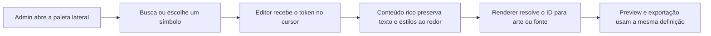

# Roadmap: paleta de símbolos e régua do modo Admin

- **Status:** requisito futuro documentado; não implementar durante a revisão visual atual.
- **Dependência:** iniciar depois de o viewer reproduzir o PDF de referência, as caixas de texto estarem revisadas e os textos/imagens duplicados terem sido removidos nas páginas do escopo.
- **Objetivo:** permitir que quem traduz insira símbolos difíceis de reproduzir no ponto do cursor e que quem revisa geometria meça posições diretamente na página.

## Paleta de símbolos especiais

### Necessidade

O texto traduzido precisa reutilizar sinais visuais do livro que não são caracteres comuns de teclado. Exemplos já observados incluem o ícone do **Blue Totem**, o raio e o rótulo **IMPORTANT**, dados e faces de dados, ícones de cores/tipos de dado, etiquetas **EXHAUST** e **DISCARD**, marcadores em quadrados com letras (A, B, C…), setas, caixas de seleção e outros símbolos de regra. Alguns desses elementos hoje aparecem como glifos de fontes simbólicas; outros são pequenas artes. O tradutor não deve precisar descobrir um caractere Unicode privado, lembrar um atalho de fonte ou desenhar o ícone à mão.

### Experiência desejada

- A paleta é aberta por um botão na lateral esquerda, onde há espaço disponível. Ela pode ser recolhida sem alterar a área de leitura.
- O botão e a paleta existem **somente no modo Admin**. No viewer normal, não são montados nem ocupam espaço.
- A paleta organiza itens por categoria e oferece busca por nome, descrição e sinônimos em inglês/português. Cada opção mostra uma prévia visual e um rótulo acessível.
- Clicar num item insere-o na posição atual do cursor do **Rich Span Editor**. O cursor/foco volta ao editor; desfazer/refazer, seleção, cópia e colagem tratam a inserção de forma previsível.
- Se houver seleção de texto, a primeira versão deve substituir essa seleção. Se o cursor não estiver num campo editável, a paleta mostra que é preciso selecionar um trecho antes de inserir.
- O símbolo deve manter alinhamento e tamanho relativos ao texto e sobreviver à troca de idioma, ao recarregamento do editor e à exportação futura.

### Modelo de conteúdo recomendado

Representar símbolos por identificadores semânticos estáveis, não por caracteres PUA crus. Exemplos ilustrativos:

```json
{ "type": "symbol", "id": "token.blue-totem" }
{ "type": "symbol", "id": "die.face.purple.3" }
{ "type": "symbol", "id": "callout.marker", "value": "A" }
{ "type": "tag", "id": "condition.exhaust", "label": "EXHAUST" }
{ "type": "notice", "id": "notice.important", "label": "IMPORTANT" }
```

O formato é uma proposta para orientar a implementação, não um contrato de API ou migração de banco já aprovado. A camada semântica permite trocar a arte de exibição sem perder o significado e distingue ícones fixos de rótulos traduzíveis. Por exemplo, o ícone do Blue Totem é invariável; o texto do selo pode ter tradução; a letra de um marcador é um parâmetro editável; um dado pode ser um conjunto de símbolos ou uma face com valor.

Catálogo futuro deve guardar, por item: `id` estável, categoria, nomes de busca e rótulo acessível, tipo (ícone, selo, dado, marcador parametrizado), arte/fonte e versão, dimensões/avanço e alinhamento de linha, comportamento de localização, regras de inserção e uma amostra de uso validada contra o PDF original. A tradução gravada deve guardar o ID e parâmetros do símbolo, não somente seu desenho renderizado.



### Grupos iniciais para inventariar

1. **Marcadores e navegação:** letras em caixas A–Z necessárias, setas, conectores e caixas de seleção.
2. **Fichas e alvos:** Blue Totem e outros tokens coloridos/de cenário que apareçam dentro de texto.
3. **Dados e resultados:** ícones de dados por cor/tipo, faces/valores e símbolos de resultado.
4. **Regras e condições:** raio de **IMPORTANT**, selos **EXHAUST**, **DISCARD**, **PASSIVE**, custos de SP e ícones recorrentes.
5. **Estatísticas e combate:** escudos, caveiras, dano, armadura, movimento, convicção/conjuração e demais símbolos recorrentes.

O inventário deve ser deduplicado por significado e conferido nas ocorrências do PDF; imagens inteiras, cartas e ilustrações não devem virar milhares de entradas individuais. Priorizar os componentes que aparecem dentro de parágrafos e que o tradutor precisa inserir no meio de uma frase.

### Fontes disponíveis no repositório

`apps/web/public/fonts/` contém as famílias visuais usadas pelo projeto: Optima LT Std (Roman, Medium, Demi, Bold, Black e Extra Black, com variantes itálicas conforme o arquivo), Adobe Garamond Pro (Regular, Italic, Bold e Bold Italic), Cinzel, Cinzel Decorative, Esmeralda Pro, Esmeralda Pro PUA, Aristelle Sans, Wingdings, Webdings e a derivação `Middara-Wingdings-p63.ttf`. As declarações de uso web estão em `apps/web/src/fonts.css`.

Wingdings, Webdings, o derivado da página 63 e a fonte PUA são fontes de mapeamento especial: um mesmo caractere digitado pode não significar o mesmo glifo em outra fonte ou editor. Portanto:

- a paleta deve mostrar e inserir nomes semânticos, sem expor códigos PUA ou exigir troca manual de fonte;
- preferir SVG/vetor versionado para ícones próprios sempre que isso mantiver a aparência de referência; recorrer ao glifo tipográfico quando o mapeamento e a licença/portabilidade estiverem confirmados;
- registrar a fonte, o codepoint e o glifo de origem como metadados de compatibilidade quando um símbolo vier de Wingdings/Webdings/PUA;
- comparar cada token renderizado com recorte correspondente do PDF, em tamanho de texto real e em zoom de leitura;
- verificar fontes incorporadas no PDF e arquivos efetivamente usados antes de declarar o catálogo completo. A lista acima é o inventário dos arquivos atualmente presentes no app, não uma afirmação de que todo caractere da fonte original está mapeado.

### Alternativas de interface

- **Preferida:** botão fixo discreto na lateral esquerda que abre um painel recolhível com busca e categorias. Aproveita o espaço apontado pelo usuário e dá área para prévias sem cobrir o texto editado.
- **Alternativa compacta:** botão de símbolos na barra de ferramentas do Rich Span Editor, abrindo um popover ancorado ao cursor. Ocupa menos espaço, mas pode cobrir o trecho e dificulta comparar muitos glifos.
- Um menu de contexto ao clicar com botão direito pode ser um atalho posterior, mas não deve ser a única forma de acesso nem substituir a busca visual.

## Régua do modo Admin

- Adicionar uma régua ao header flutuante/ferramentas do viewer **apenas enquanto o modo Admin estiver ativo**. Fora do Admin, ela não deve ser renderizada no DOM nem reservar área.
- A régua mede coordenadas da página em unidades PDF (pt) e acompanha zoom/scroll. Pode mostrar divisões menores e coordenadas X/Y do ponteiro ou da seleção.
- A régua é uma sobreposição de diagnóstico: não altera o PDF, os blocos, a geometria salva nem a exportação final.
- Ter controle visível para ativar/desativar a régua no Admin; manter o estado desligado por padrão até ser habilitado pelo usuário.
- Conferir medidas contra dimensões da página e caixas selecionadas. Não arredondar as coordenadas internas por causa da apresentação em pixels.

## Botão de FAQ

- Ideia futura: incluir um botão **FAQ** no app que mostre uma cópia do conteúdo da página oficial [Errata | FAQ da Succubus Publishing](https://middara.com/pages/faq), para que as respostas fiquem acessíveis dentro do produto.
- Preservar títulos, links e contexto de errata, registrar a URL oficial como fonte e exibir quando o conteúdo foi sincronizado. Definir depois uma forma de atualizar a cópia quando a publishing alterar a página; manter também um link para abrir a fonte oficial.
- Não implementar durante a revisão visual atual. Retomar junto às ferramentas auxiliares do viewer, após a etapa de fidelidade visual.

## Ordem e critérios de conclusão

1. Concluir a reprodução visual das páginas em escopo, remover fantasmas e validar caixas contra o PDF de origem.
2. Fazer inventário de símbolos repetidos, ocorrências, fonte/codepoint ou arquivo vetorial, bounding box, baseline e necessidade de localização.
3. Definir a representação semântica e provar round-trip banco → editor → renderer → recarga para um token fixo, um selo traduzível e um marcador parametrizado.
4. Implementar a paleta como ferramenta exclusivamente Admin, começando por busca, prévia, inserção no cursor e desfazer/refazer.
5. Adicionar a régua Admin e confirmar que fica completamente ausente do viewer normal e de qualquer exportação.
6. Validar tokens em páginas representativas lado a lado com o PDF original e só então expandir o catálogo.

Critério de aceite: o tradutor consegue inserir Blue Totem, **IMPORTANT**, dados e marcadores sem conhecer fontes/códigos especiais; o significado e a formatação permanecem editáveis; fontes/arte não produzem glifos fantasmas; e nenhuma ferramenta Admin aparece na leitura normal.
